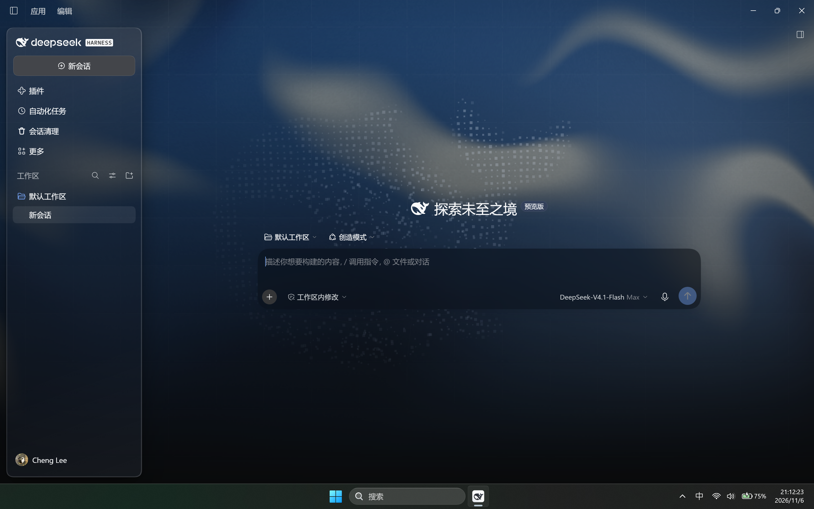
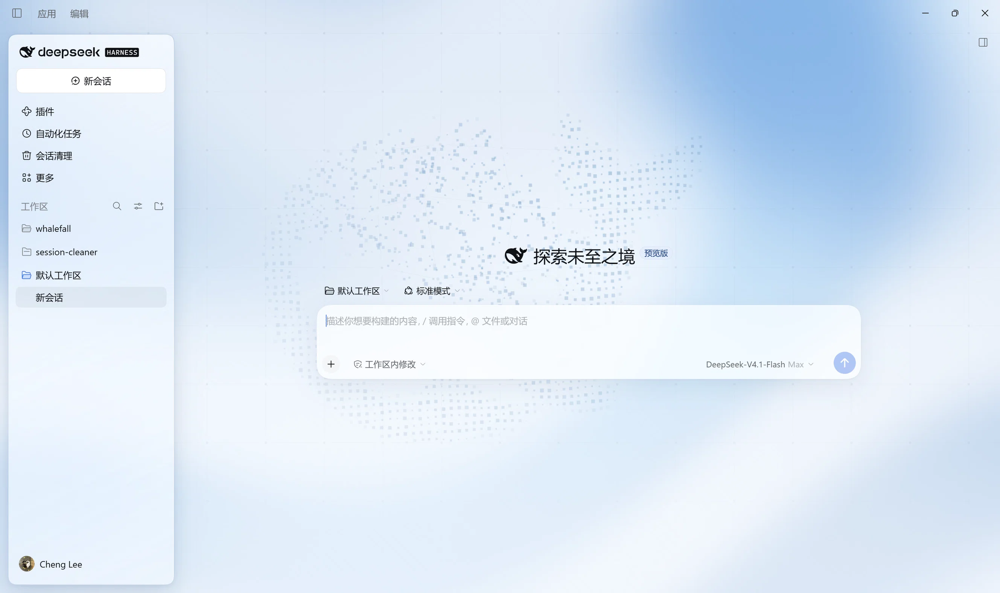

# Whalefall

An aurora and whale glassmorphism background theme for the DeepSeek Harness web UI.

- Follows DeepSeek Harness's light and dark themes.
- Aurora, particle whale and star-grid effects animate with the interface.
- On the home screen the particle whale breaks apart on the same blank-space click that starts the official home whale's dive animation: the silhouette swells and shatters into drifting particles within about 0.3 s and has faded out by about 0.6 s, so it never shares the frame with the official whale. The dust then flows back into a whale once the official animation has finished.
- The sidebar, composer and some content panels use translucent glass: the left sidebar is a frosted-glass card, the right sidebar is clear glass.
- Tooltips and session / workspace hover cards are themed glass layers, so they no longer show up as dark slabs in the light theme.
- Dropdown menus (the command menu, the model menu and other menu surfaces) use the same frosted glass: a neutral, semi-transparent fill with a real backdrop blur, a diagonal sheen and a 1px inner edge.
- Respects the system reduce-motion setting.

## Preview

### Dark theme



### Light theme



## Installation

Designed for DeepSeek Harness 0.2.x. Clone the repository and run the following from its root:

```powershell
git clone https://github.com/li-zheng-prog/whalefall.git
cd whalefall
dsh plugin --profile desktop add .
```

You can also install this directory through the DeepSeek Harness plugin manager. If the theme does not take effect immediately, reload or restart DeepSeek Harness.

## Notes

The theme depends on DeepSeek Harness's UI structure, so some styles may need adjustment after an upgrade. The particle whale and some aurora effects require WebGL 2.

The home hand-off starts on the blank-space click that starts the official animation, then watches the official home whale canvas for playback and its end, so it needs no fixed animation length. The dissolve is driven by a per-particle drift field: a short, shape-preserving outward swell followed by a random scatter, with the particles fading as they travel, so the whale disperses instead of collapsing into a dot. `window.__dshWhaleTune.spread` scales the scatter distance for tuning. If that canvas is missing or unreadable, the particle whale simply stays visible as before.

## License

[MIT](LICENSE)
